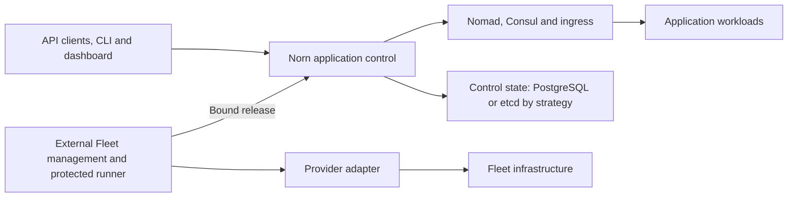

# Norn

Norn is an application control plane for people who need to deploy services and
keep operating them. Define an app once, rehearse a change, follow its deployment,
and inspect the result through one API, CLI, and dashboard.

Nomad schedules workloads, Consul provides service discovery and health, and
Norn connects application source, secrets, dependencies, readiness, and recovery.
**Norn 3.0.0** adds the first live-qualified Fleet online platform-upgrade path.

[Get started](docs/v3/guide/getting-started.md) ·
[Why Norn](docs/v3/guide/why-norn.md) ·
[Architecture](docs/v3/architecture/overview.md) ·
[Documentation](https://antiartificial.github.io/norn/v3/)

## From an application definition to a running service

| Task | What Norn provides |
| --- | --- |
| Discover | App and service state, allocations, endpoints, secret status, logs, and events |
| Rehearse | Source preparation, build/test checks, and input validation before promotion |
| Deploy | Recorded stages through configured snapshots/migrations, scheduler submission, readiness, and routing |
| Drain | Active-work and capacity checks before platform maintenance or node removal |
| Recover | Operation history, snapshots, rollback, explicit readback, and retained evidence |

An `infraspec.yaml` describes source, build, HTTP services, workers, scheduled
jobs, functions, resources, health, secrets, and dependency bindings. New drafts
stay disabled until reviewed. Follow the [application guide](docs/v3/guide/applications.md)
and [daily workflow](docs/v3/operations/workflow.md).

## Choose your release strategy

**Self-hosted** provides a lighter single-host experience with local runtime
integration and PostgreSQL control state. **Fleet** provides multiple nodes,
etcd-backed control state, external management, and protected infrastructure
execution. Application databases remain separate from control state.



Provider credentials stay in the protected infrastructure executor. The private
`norn-fleet` repository owns desired infrastructure, provider adapters, and
bootstrap. DigitalOcean is the current implemented and qualified adapter.
Additional providers require their own implementations and qualification;
provider-agnostic ownership does not mean multi-cloud support is complete.

See [Fleet operations](docs/v3/operations/fleet.md),
[online platform upgrades](docs/v3/operations/online-upgrades.md), and
[capability status](docs/v3/reference/capabilities.md). The successful upgrade
qualified one source pair and topology. Fresh creation, controller workload
admission, mixed-version resizing, and stateful compatibility retain separate
qualification requirements.

## Build a local development environment

Use Go 1.26.10, Node.js 24, pnpm 10+, PostgreSQL 16+, Docker, Nomad, Consul,
and SOPS with age. Run from the active implementation directory:

```sh
git clone https://github.com/antiartificial/norn.git
cd norn/v2
make doctor
make build
pnpm --dir ui install --frozen-lockfile
make ui
```

Continue with the [V3 getting-started guide](docs/v3/guide/getting-started.md)
to start the local runtime and inspect your first app. This development setup
is not a production Fleet bootstrap or security configuration.

## Documentation and release identity

- [Why Norn](docs/v3/guide/why-norn.md)
- [Getting started](docs/v3/guide/getting-started.md)
- [Application definitions](docs/v3/guide/applications.md)
- [Daily operations](docs/v3/operations/workflow.md)
- [Operation semantics](docs/v3/operations/operations.md)
- [Fleet operations](docs/v3/operations/fleet.md)
- [Recovery and qualification](docs/v3/operations/recovery.md)
- [Version and signed-artifact identity](docs/v3/reference/versioning.md)
- [Release evidence](docs/v3/release-program-milestones.md)

The `v3.0.0` source tag identifies this product milestone and its documentation.
Controllers still select immutable signed artifacts by full source SHA and
manifest identity. A source tag does not publish or deploy a new bundle.

[V1](docs/v1/guide/getting-started.md) and [V2](docs/v2/index.md) docs are retained.
The root `api/`, `cli/`, and `ui/` trees are the frozen Kubernetes implementation.
Current API, CLI, dashboard, and platform scripts live under `v2/`; new product
documentation lives under `docs/v3/`. Neither the directory name nor `/api/v1`
is a product release number. The proposed [repository split](docs/v3/architecture/repository-boundaries.md)
separates Fleet and self-hosted lifecycle code without duplicating contracts.
