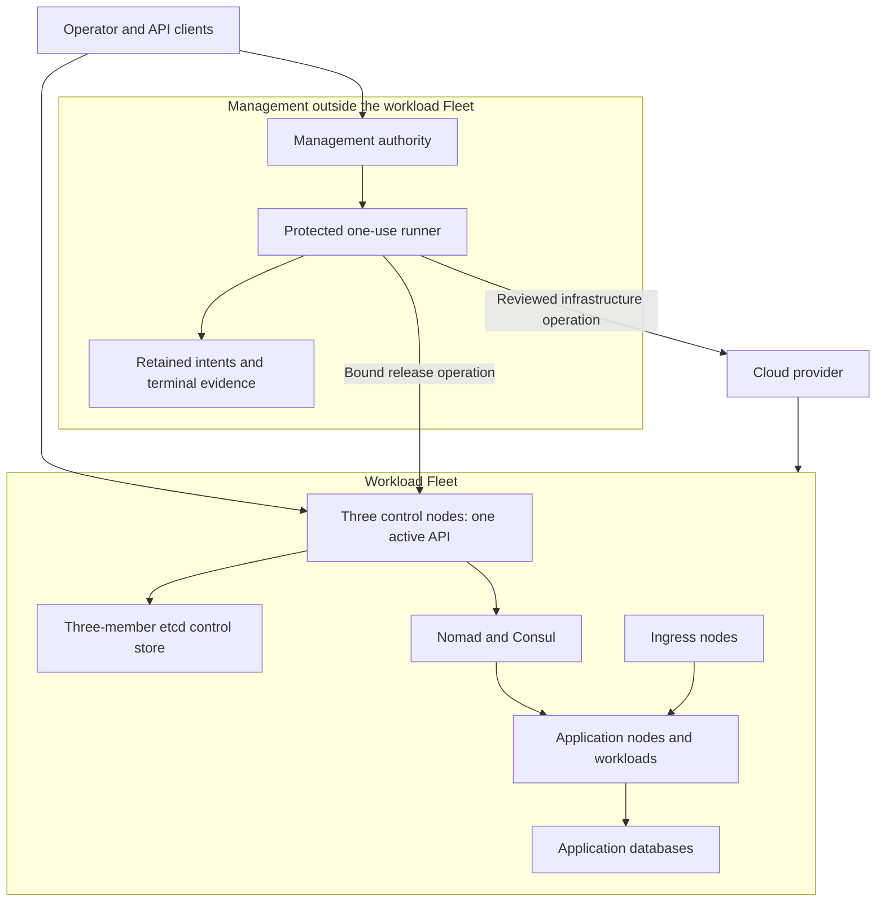

# V3 architecture

Norn separates application control, infrastructure effects, and the management
authority that can recover the Fleet. The tested Fleet uses etcd for control
state. Application databases and the management database are separate resources.
The self-hosted strategy uses PostgreSQL for its control state.

## Runtime ownership

The API exposes application and operational contracts to the CLI, dashboard,
and other clients. Nomad schedules workloads, Consul provides discovery and
health, and ingress routes traffic to application allocations. These components
are not replaced merely because the Norn API binary changes.

The online platform release rotates the Norn control processes and signed UI
assets on the controls. It preserves application pools and workload sizes.
It does not prove a rolling host-OS, Nomad, Consul, or database-engine upgrade.

## Authority and evidence

The release intent binds exact source and artifact identities, hosts, owner,
observation policy, and operation identity. The runner checks those inputs
before effects and records progress durably. An ambiguous effect requires
readback under the same operation identity, not an automatic repeat mutation.

Management remains outside the Fleet's retirement scope. Evidence, state
backends, and recreation credentials survive the pilot. A successful cloud
DELETE request is not final absence evidence; asynchronous deletion needs
provider readback.

## Storage boundaries

| Concern | Tested Fleet role |
| --- | --- |
| Control correctness | etcd-backed Fleet control state and ownership |
| Application data | Application-specific PostgreSQL, MySQL, or other bindings |
| Management state | Separate management authority and its database |
| Evidence and diagnostics | Retained operation artifacts and observations outside the disposable Fleet |

The [repository boundary](repository-boundaries.md) explains the proposed
separation of Fleet and self-hosted product code. The [upgrade procedure](../operations/online-upgrades.md)
describes the qualified control rotation.
