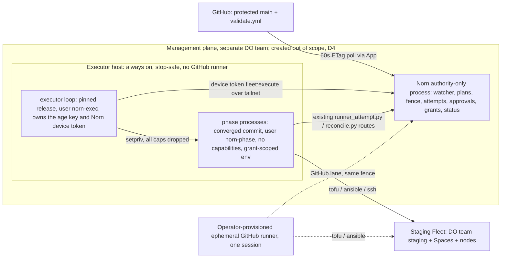

# Fleet controller plan, changes 5–7: controller-run execution (revision 3, final)

Status: **final revision**. It responds to [`plan-5-7-review.md`](./plan-5-7-review.md),
both the original review and its "Revision 2 check". The human made
decisions D1–D8 (§0), accepted 2026-10-04. §9 maps every review finding to
its resolution. No code was changed by this pass.

Inputs: [`proposal.md`](./proposal.md), [`plan.md`](./plan.md) §2/§5,
[`operator-runbook.md`](./operator-runbook.md), [`final-review.md`](./final-review.md),
[`qualification-2026-10-04.md`](./qualification-2026-10-04.md),
[ADR 0009](../adrs/0009-fleet-controller.md).

Branch: `feature/v3-fleet-executor`, stacked on `feature/v3-fleet-controller`
(changes 1–4).

Path prefixes:
- `norn:` is relative to `v2/api/` in this worktree.
- `fleet:` is relative to the norn-fleet checkout at `daf7bf3`
  (`/Users/arti/Desktop/Claude/norn-fleet-controller-executor`, read only).
- `ui:` is relative to `/Users/arti/Desktop/Claude/NornUI`.

**Requirement.** The human's direction: *"very streamlined … the platform
has keys to run and deploy the fleet via the controller and GH is used to
trigger."* The management plane holds the deploy credentials, and GitHub
only says "converge to revision X".

This reverses two earlier positions:
- proposal constraint 4;
- `docs/v2/operations/fleet-pilot.md:121-128`.

The Norn **API process** still holds no provider credentials (§3).

---

## 0. Decisions (human, accepted 2026-10-04)

**D1. Shape: B-lite on a management executor host.**
- A pinned Python loop runs under systemd. There is no Go supervisor.
- None of these exist: a claim protocol, an executor registry, an
  executor-lane nonce, an incarnation counter, migration 50, or a
  writer-floor bump. **The writer stays at 32.**
- The loop uses the existing runner-attempt routes. A new executor branch
  acquires and binds the fence and inserts the attempt in one transaction.
- Extra state goes in existing JSONB and operation payloads.
- The executor authenticates with a dedicated principal built on the
  smallest existing mechanism. It never uses the GitHub OIDC path.

Details: §2.1–§2.6.

**D2. Merge gate.**
- Config-only diffs auto-apply after trigger verification.
- Any executable path needs a one-click `approve`: `scripts/`, `ansible/`,
  `modules/`, `cloud-init/`, the executor itself, and similar.
- Destructive or contraction plans always need approval.
- All of this is reported through the WP13 `approvalPolicy`.

Details: §2.5.

**D3. Secrets: SOPS/age now, OpenBao next.**
- Phases go through a credential-provider interface and never read secret
  files directly.
- Norn issues attempt- and phase-scoped credential grants.
- Phases run as a different OS user from the age-key owner.
- Management lives in a separate DigitalOcean team from staging.
- Rotation has a named delivery path.
- OpenBao is a follow-on, not a work package.

Details: §2.3, §8.

**D4. Creating the management plane is out of scope.**
- Everything else is built and tested locally.
- Real-staging qualification (Q2) is gated on the management plane
  existing.

Details: §4.

**D5. Reviewer defaults accepted.**
- Trigger: a 60 s ETag poll. A commit counts as verified when the branch
  `protected` flag is set and a successful `validate.yml` push run exists
  at that SHA.
- Converge always targets the latest verified tip, never anything older.
- Production stays on the GitHub lane.
- Automatic recovery budget is 0 until M5 and B3 are qualified, then 1 per
  plan.

Details: §2.4, §2.7.

**D6. The executor host is always on and stop-safe.**
- It can be stopped or powered off at any moment without losing anything.
- Every phase resumes or recovers through the existing attempt,
  checkpoint and stop-proof machinery.
- There is no on-demand power-on. That is a possible later add-on behind a
  narrowly scoped DO token (power actions on one droplet).

Details: §2.7.

**D7. No resident GitHub runner on the management plane.**
- The GitHub lane covers production, destructive and contraction plans,
  external-Mac and pilot work.
- It runs only on an **operator-provisioned ephemeral runner**: the
  operator's own machine running `--ephemeral`, or a temporary droplet.
  The runner lives for one operator session.
- Nothing executed by GitHub ever runs on the executor host.
- The fence arbitrates between the ephemeral runner and the executor.

Details: §2.9, §2.12, WP G1.

**D8. The executor token.**
- It is scoped to `fleet:execute` and lives **7 days**.
- It is rotated through the existing route.
- It is revoked immediately when the host is rebuilt or retired.
- OpenBao replaces it later.

Details: §2.3.

---

## 1. Current-state map: standard staging create or scale-up today

### 1.1 Workflows (norn-fleet `.github/workflows/`, 12 files, 5,722 lines)

| Workflow | Trigger | Runner | Credentials | Norn API |
|---|---|---|---|---|
| `validate.yml` (175) | `pull_request`, push to `main` (:3-6) | `ubuntu-24.04` or the ephemeral CI runner (:22) | none | none |
| `plan.yml` (333) | push to `main` on the infra paths (:5-18) | **GitHub-hosted**, environment `staging-plan` (:89, :114) | DO, `STATE_*`, fingerprints, CIDRs (:176-181, :275-300) | none; it writes the artifact `fleet-plan-<env>-<run>` |
| `apply.yml` (1,386) | `workflow_dispatch` from Norn's App (:4-46) | staging and production use `[self-hosted, norn-fleet]` (:111); pilots use `norn-fleet-protected`/`norn-pilot-<run>` labels; environment `staging` or `production` (:120) | DO, Spaces, `id-token: write`, release token; runner-local SSH key, `known_hosts`, bootstrap dir | OIDC exchange, start, heartbeat, checkpoint, advance |
| `recover.yml` (1,886) | `workflow_run` on apply failure, or dispatch (:4-44) | `[self-hosted, norn-fleet]` (:394) | as apply; intent `recover` | `start --resume`, checkpoints |
| `drift.yml` (259) | cron `17 11 * * *` + dispatch | `fleet` job **GitHub-hosted** (:172-186); `external_mac` job on the pilot runner (:25) | DO, Spaces | none (the result never reaches Norn) |
| `retire-`/`finalize-external-mac.yml` | dispatch | `retire`: pilot runner `[self-hosted, norn-fleet-protected, norn-pilot-<run>]`; `finalize`: the reusable macOS finalizer (`norn-external-mac-finalizer`) | DO, Spaces, Tailscale | none |
| 4 × `pilot-*-approval.yml` | dispatch | hosted | none | none |
| `pre-release-pilot-qualification.yml` | dispatch | `macos-15` / ephemeral | none | none |

### 1.2 Step by step (`fleet:docs/runbooks/routine-apply.md:21-30`)

| # | Actor | Step | Credentials |
|---|---|---|---|
| 1–2 | Operator → Norn → GitHub | signed `fleet.capacity-plan` (`norn:handler/fleet.go:155`), then a PR `norn/plan-<id>` | user token; App |
| 3–4 | GitHub | `validate`, then **human merge**, then `validate` + `plan` on push | DO + Spaces (plan) |
| 5 | Operator | **reviews the plan artifact** | — |
| 6 | Operator → Norn → GitHub | `DispatchFleetGitHubApply` (`handler/fleet_github.go:751-921`): `ResolveApprovedPlan` (`githubapp/client.go:612-732`), nonce, reservation, fence acquire, `submitting` (`store/fleet_github_dispatches.go:127-175`), dispatch, finish; ≈8 GitHub calls | App |
| 7–9 | apply.yml | re-verify the plan run (:317-341), re-plan, verify the hash, run policy (:627-684), write the binding artifact (:754-783) | DO, Spaces, runner files |
| 10 | apply.yml → Norn | OIDC exchange, then `runner_attempt.py start`. Norn checks the nonce, plan SHA, commit, run and **`ref_protected`** (`handler/github_actions_oidc.go:292`; `handler/fleet_runner.go:694-754`, :727) | 15-minute token |
| 11–12 | apply.yml → Norn | `supervise -- tofu apply`, heartbeat every 40 s (`runner_attempt.py:152-190`); then `reconcile.py` hooks, each phase doing checkpoint + advance (`reconcile.py:720-812`) | DO, Spaces, SSH, bootstrap, release token |
| 13 | recover.yml | source run, binding, `--resume`, re-plan the remainder, resume | as apply |
| 14 | drift.yml | daily `tofu plan`; Norn never sees the result | DO, Spaces |

PG legacy non-drain phases (`norn:fleet/lifecycle/phases.go`):
`infrastructure_applied → inventory_generated → nodes_configured →
nodes_enrolled → readiness_verified → complete`.

### 1.3 Quantified

| Measure | Today |
|---|---|
| Human touches after authoring | 3: merge, artifact review, dispatch. Authoring through Norn adds plan and PR |
| Distinct workflows | 3 on the happy path, 4 with recovery, 5 with drift |
| Credentialed runs per change | 2 (plan, apply), plus recovery, plus 1 drift run per day |
| Independent validations of one plan identity | 4 |
| Values carried Norn → GitHub → Norn | 5 inputs, plus the nonce in the run title (`client.go:59`), plus the binding artifact |
| Runner → Norn control writes, excluding heartbeats | ≈16: 3 OIDC exchanges on the non-contraction lane (apply.yml:818, 967, 1009), 1 start, 6 checkpoints, 6 advances; plus ≥12 reads |
| Heartbeats | ≈70 for a 45-minute create |
| Ambiguity points that need GitHub proof | 3 (H4, runner start, Q11) |

**Where the back-and-forth comes from:**
- Plan and apply are split across workflows, with a human and an artifact
  between them.
- A nonce/OIDC bridge carries trust between two domains.
- Outcome evidence lives in GitHub.
- Drift results never reach Norn.

---

## 2. Target: B-lite controller-run execution

### 2.1 Shape



**Standard path:**

1. Merge to protected `main`.
2. The **watcher** verifies the new tip (§2.4) and classifies the paths it
   touches (§2.5). It then records two things:
   - a desired revision;
   - a converge plan: a `fleet.capacity-plan` with `action: converge`,
     `commitSha`, `pathClass`, `requiresApproval`, merge actor and PR
     number.
3. The **loop** polls the existing `GET resources/{name}` (the only read
   the executor principal has; it reads `desired.converge {planSha256,
   requiresApproval, approved}`, pinned as `executor.ConvergeView`). It
   acts when all of these hold:
   - the desired generation is newer than the applied one;
   - `executionMode=controller`;
   - any required approval is present;
   - the fence is `Free`.
4. The loop requests a `plan` grant and checks out and verifies the commit
   (§2.4). It then runs `tofu plan` and `plan_policy.py` as `norn-phase`.
   A destructive result stops here (§2.5).
5. It calls the **existing** attempt-start route. The executor branch runs
   acquire, bind and insert in one transaction (§2.6).
6. For each remaining phase it requests a grant, then runs either
   `tofu apply` or `reconcile.py`, as today. Reaching `complete` releases
   the fence.

**Result:**
- Human touches: author and merge, plus one `approve` when executable
  paths changed.
- Credentialed GitHub workflows on this lane: 0.
- Norn → GitHub calls: one conditional head read per minute (a 304 costs
  nothing), plus about 4 calls per new tip.

### 2.2 Placement (decided: D1, D6, D7)

| Option | Verdict |
|---|---|
| A. In the authority process | **Rejected.** Provider keys would share a process with the App key and the audit key, and a restart would kill applies. |
| B. Go supervisor with a claim protocol and a registry (rev 1) | **Superseded.** It needed about 17 new parts. |
| **B-lite. Python loop under systemd on a dedicated executor host** | **Chosen.** |
| C. Nomad batch jobs on management | **Rejected.** New infrastructure (`fleet-pilot.md:84-86`). |
| E. Self-hosted GitHub runner holding SOPS keys | **Rejected by D7.** It co-locates GitHub-executed code with standing keys, and keeps the nonce, OIDC and dispatch ambiguity. |

**Executor host.**
- This is the second droplet in the management root
  (`fleet:environments/management/nyc3/main.tf:122-131`, declared there as
  "runner"). It has no GitHub runner agent, now or during migration (D7).
- It does not exist yet
  (`fleet:docs/runbooks/management-authority-runner-state.md:9-11`).
  Creating it is D4.
- The host is **always on** (D6). Stop safety comes from §2.7: the loop
  never relies on local state that Norn or the remote OpenTofu state
  cannot reproduce.

### 2.3 Credentials (D3, D8)

#### Users and capabilities (R1)

**`norn-exec` runs the loop.**
- It runs from a **pinned norn-fleet release**: `scripts/executor/` and
  `scripts/executor.py` at a reviewed commit, installed by Ansible into
  `/opt/norn-fleet-executor/<sha>/` with a verified tree hash.
- It owns the age key (`0400`) and the Norn device token.
- The unit grants `AmbientCapabilities=CAP_SETUID CAP_SETGID CAP_SETPCAP`
  **to the loop only**. It also sets
  `CapabilityBoundingSet=CAP_SETUID CAP_SETGID CAP_SETPCAP`,
  `KillMode=control-group`, `ProtectSystem=strict`, `PrivateTmp=yes`,
  restricted `ReadWritePaths`, and **no `Delegate=`**. `CAP_SETPCAP` is
  required: `setpriv --bounding-set=-all` drops the bounding set with
  `PR_CAPBSET_DROP`, which fails without it (P1 review). It adds nothing
  beyond the bounding set the unit already allows.
- Ambient capabilities reach every child of the loop, not only `setpriv`.
  The loop therefore starts `sops` through `setpriv` with every set
  dropped and its own uid; `git` and `tofu version` still inherit
  `CAP_SETUID`/`CAP_SETGID` (P2 or P5 should wrap them the same way).

**`norn-phase` runs each phase.**
- It runs the converged commit's work tree.
- Every phase is started with:
  `setpriv --reuid=norn-phase --regid=norn-phase --clear-groups
  --inh-caps=-all --ambient-caps=-all --bounding-set=-all
  --no-new-privs -- …`
- The phase therefore has empty effective, permitted, inheritable, ambient
  and bounding sets. It cannot `setuid` back to `norn-exec`, and it cannot
  read `/etc/norn-fleet-executor/` or `/var/lib/norn-fleet-executor/`.
- `sudo`, `su` and `systemd-run` are never used, because a PAM session,
  a transient scope or a transient unit would leave the unit cgroup and
  escape `KillMode=control-group`.
- The loop cannot signal phase processes (different uid, no `CAP_KILL`).
  After every phase, and on timeout or interruption, it runs a one-shot
  `kill(-1, SIGKILL)` **as `norn-phase`** through the same `setpriv` line.
  That kills every `norn-phase` process, including one that left the
  phase's process group with `setsid`, so no phase process outlives its
  grant and none can read or rewrite the next phase's grant files.
- P5 denies `cron` and `at` to `norn-phase`, so no phase process can be
  started later outside the unit.
- P1 tests all of this (`PhaseHasNoCapabilities`,
  `PhaseCannotReadAgeKey`). The VM test spawns the phase from a
  `norn-exec` process holding exactly the unit's capabilities, not from
  root, because root hides a missing `CAP_SETPCAP`.

**Limits.** Per-phase scoping is hygiene, not containment. Phase code from
the converged commit runs with its grant's real credentials. The control
against hostile phase code is the **D2 approve**.

#### Credential provider interface

`scripts/executor/credentials.py`:

```python
class CredentialProvider(Protocol):
    def issue(self, grant: Grant, types: list[CredentialType]) -> dict[str, str]
    def revoke(self, grant: Grant) -> None   # SOPS: no-op; OpenBao: revoke lease
CredentialType = Literal["do-read", "do-write", "spaces-rw", "spaces-read", "ssh-node",
                         "bootstrap-dir", "release-github", "norn-attempt"]
```

`SopsProvider` decrypts `/etc/norn-fleet-executor/staging.sops.yaml` once
per grant. It returns only the requested types. File-shaped types (SSH key,
bootstrap dir) are written under `/run/norn-fleet-executor/grants/<id>/`,
owned by `norn-phase` with mode `0600`. That directory is tmpfs, so a power
loss erases it. The provider deletes the directory when the phase exits,
and the loop removes every leftover grant directory when it starts.

**Grant layout (P1 review, kept).** `grants/` is `norn-exec:norn-phase
0750`: a phase can traverse it but not create, rename or delete entries.
Each `<id>/` is `norn-exec:norn-phase 0770` and its files belong to
`norn-phase`, written by a one-shot helper run as `norn-phase` (so the loop
needs no `CAP_CHOWN`; `norn-exec` is in the `norn-phase` group only to set
the directory group). A phase can reach nothing of `norn-exec`. Because
every phase has the same uid, the file layout cannot separate one phase
from the next; that separation comes from one phase at a time, the
uid-wide kill after each phase, and revocation before the next grant.
Files a phase leaves in places it can write (its home, the work tree,
`/tmp`) are not covered: P2 gives each phase `HOME` and `TMPDIR` inside its
grant directory and keeps the work tree read-only to `norn-phase`.

#### Norn-issued grants (audit from day one)

The loop calls `POST /api/v1/fleet/plans/{id}/credential-grants
{attemptId?, phase, types[]}` with its executor principal.

Admission rules:
- For `provider_applying` and later phases, the attempt must be live and
  owned by this executor, and `phase` must equal `currentPhase`.
- For `plan`, no attempt exists yet, but the plan must resolve to the
  executor's target.
- Each type must appear in the table below.

On success, Norn writes a ledger operation `fleet.credential-grant` with
plan, attempt, phase, types, device ID and a 2-hour expiry, and returns
`{grantId, expiresAt}`. The provider refuses to issue anything without a
grant ID.

| Phase | Allowed types |
|---|---|
| plan | do-read, spaces-rw (the lockfile needs write; `plan.yml:292` uses `use_lockfile=true`) |
| provider_applying | do-write, spaces-rw, norn-attempt |
| `infrastructure_applied` … `readiness_verified` | spaces-read, ssh-node, bootstrap-dir, release-github, norn-attempt; do-read only if P2 measures that `fleet_hooks.py` needs it (apply.yml passes it at :987) |
| recover | union of the rows above |

The observe grant is deferred with observation (§2.8).

#### DigitalOcean teams and root of trust

- Management sits in a **separate DO team**, part of D4.
- Each team holds a read-only token and a write-scoped token, created by
  hand in the console. DO has no API for minting scoped tokens.
- Spaces uses per-bucket keys.
- The root of trust stays in the password manager: the team owner
  accounts, Spaces admin keys, operator age keys, unseal and recovery
  material, and the initial SSH key.
- The host file holds only derived, revocable material, encrypted to the
  operators plus one host recipient. A sealed backup lives in Spaces.

#### Secret rotation delivery

1. Edit the file with `sops` and commit it to the private ops repo.
2. Run `ansible-playbook ansible/playbooks/management-executor.yml --tags
   secrets` from an operator workstation over tailnet SSH.
3. The file is copied atomically (write to a temp file, then rename) to
   `/etc/norn-fleet-executor/`.
4. The provider reads the file at **every grant**. New phases get the new
   material with no restart. A running phase keeps its grant until it
   exits.

No pull credential lives on the host.

#### Norn identity (D1, D8)

The executor uses a **device token** from the existing enrollment flow. The
authority-only process already serves enrollment, approval, exchange,
`/api/v1/auth/rotate` and `DELETE /api/v1/devices/{id}` (`norn:main.go:772-778`,
`:1935-1938`), and principals from it carry `Source=managed-token`
(`handler/tokens.go:113-118`).

**Bootstrap.**
1. On first start, the loop generates its device key and calls
   `POST /api/v1/enrollments` with `platform: "fleet-executor"`.
2. An admin approves with scopes exactly `["fleet:execute"]`.
3. The loop exchanges the approval for a token. It polls the exchange
   every 5 s while the answer is `409 enrollment_not_approved` and stops at
   the start response's `expiresAt`. Any other refusal is terminal; `401
   invalid_enrollment_verifier` counts toward the lockout and is never
   retried (`executor.EnrollmentPendingCode`).

No token is shipped in SOPS.

**Changes (E1):**
- Add the scope `fleet:execute` to `accessTokenScopes`
  (`handler/tokens.go:59-64`).
- Approval grants `fleet:execute` only alone and only to platform
  `fleet-executor`.
- `deviceTokenLifetimeForPlatform` (`handler/device_enrollment.go:357`)
  returns **7 days** for `fleet-executor`. The default is 30 days.
- The executor principal is: `Source==managed-token`, exact scope
  `fleet:execute`, and `CI==nil`.

**Rotation without downtime.**
- `RotateManagedToken` (`device_enrollment.go:262-300`) issues the new
  token and retires the old one atomically, preserving scopes and platform
  lifetime.
- The loop self-rotates once **3.5 days or less remain**, and only while no
  phase is running for it. Plenty of idle windows exist at a 7-day lifetime.
- It writes the new token to `/var/lib/norn-fleet-executor/token` (temp
  file, fsync, rename) before using it. A missing or unreadable expiry
  record counts as due, so a crash between the token and its expiry
  record heals at the next idle tick.
- Phases read the token through their `norn-attempt` grant file, which the
  loop rewrites atomically. They re-read it on every request, as
  `reconcile.py` already does (`reconcile.py:204-241`).

**If the rotate response is lost**, the old token is retired and the new
one is unknown. The loop's next call returns 401, so it stops taking work,
and it alerts. This is stop-safe (D6). The operator re-enrolls the device.

**Rebuild or retirement.** An admin runs `DELETE /api/v1/devices/{id}`
immediately (D8). The rebuilt host enrolls as a new device.

### 2.4 Trigger and verification (D5)

**The watcher.** It lives in `norn:fleet/controller/watcher.go` and runs
where the reconciler runs (Q6). Every 60 s, for each resource with
`executionMode=controller`, it calls `GET /repos/{r}/branches/main` with
`If-None-Match`. The App's existing contents/actions permissions are
enough (`githubapp/client.go:263, 372, 402, 1062`).

On a new tip, `VerifyProtectedCommit(sha)` requires:
1. `protected == true`;
2. a `validate.yml` run with `event=push`, `head_sha=sha`, `completed`,
   `success` (the same pattern as `client.go:625-640`);
3. `compare(lastApplied...sha)` reports `ahead`.

If nothing has been applied yet, the first converge needs `approve`.

**Edge cases (M6/M7):**
- **Pending checks:** re-poll later. This is not a failure. `validate.yml`
  has no push path filters, so a tip with **no** push run at all (CI skipped
  with `[skip ci]`, Actions disabled) becomes `trigger_unverified` once its
  committer date is older than 15 min (`githubapp.ValidateRunGrace`). A run
  that has started stays pending. The verdict is recomputed on every poll.
- **Completed failure:** `blocker=trigger_unverified` until a newer tip
  passes.
- **Coalesced merges:** the path class is computed over the whole
  `lastApplied..tip` range.
- **Diverged or behind:** `blocker=history_rewritten`. An admin must
  `approve` that exact tip.
- **Revert:** treated as a new tip. A reverted scale-up is a contraction,
  so it goes to the GitHub lane (§2.10).
- **Never older:** the watcher records only the newest verified tip. At
  checkout, the executor also requires `sha == origin/main` HEAD **and**
  that `sha` descends from its locally recorded last-applied
  (`/var/lib/norn-fleet-executor/last-applied`). Otherwise it waits.

**Replacing `ref_protected`.** On the GitHub lane, attempt admission
enforces the OIDC claim `ref_protected` (`github_actions_oidc.go:292`,
`fleet_runner.go:727`). The executor branch re-runs
`VerifyProtectedCommit(plan.commitSha)` before its transaction, with a
cache of 60 s or less. The plan must still be the newest desired revision.

**Not verified.** Required reviews and bypass need Administration: read.
They are reported as `not_verified`. D2 covers that gap for executable
changes.

### 2.5 Approval (D2)

The watcher classifies the `compare` file list. The classification is
default-deny:

| Class | Paths | Behaviour |
|---|---|---|
| `config` | `environments/<env>/<region>/cluster.yaml` (schema-checked by `validate.yml`), `.norn/fleet-plan-receipts/<id>.json` | auto-apply |
| `inert` | `**/*.md` outside `.github/` | no converge |
| `executable` | everything else, including `scripts/**` (the executor too), `ansible/**`, `modules/**`, `cloud-init/**`, `*.tf`, `*.tfvars` (none is committed; a committed `*.auto.tfvars` overrides `TF_VAR_*` such as `ssh_key_fingerprints`), `reconcile-hooks.json`, `schemas/**`, `.github/**`, and non-Markdown `docs/**` (scripts read `docs/policies/*.json` and `docs/incidents/*.json`) | one-click `approve` first |
| destructive / contraction (from `plan_policy.py`/`contraction_policy.py` after the plan) | — | **GitHub lane only**: `blocker=destructive_requires_github_lane`. The operator's dispatch with `allowDestructive` is the approval |

**Cost of the GitHub-lane rule.** A reverted scale-up needs the full GitHub
flow: `norn fleet plan`, PR, merge, artifact review, dispatch. It also needs
an ephemeral runner session (§2.12). Staging keeps `plan.yml` and its
GitHub environment secrets.

**`approve`.** This is a signed operation `fleet.converge.approve {planId,
commitSha, resume?, sourceAttemptId?}` in the existing ledger. It needs
`platform:operate`, a non-CI caller and an `Idempotency-Key`.
- At attempt start, the executor branch refuses a `requiresApproval` plan
  that has no matching approve (`fleet_converge_approval_required`).
- With `resume:true` it authorizes one recovery attempt (§2.7).

**`approvalPolicy` additions.** These are additive and `omitempty`; they go
in `fleet/controller/types.go:213-222` and `handler/fleet_resources.go:243-253`:
- `ProtectedBranchVerified`
- `ValidateWorkflowSucceeded`
- `MergeGate="config_auto_executable_approve"`
- `DestructiveApproval="github_lane_dispatch"`
- `ApprovedBy`
- `RequiredReviews="not_verified"`

`Verification` gains `"github-protected-main"`.

### 2.6 Plugging into changes 1–4 (no second ledger, no migration)

| Concern | Executor lane |
|---|---|
| Plan | The watcher records a `fleet.capacity-plan` with `action: converge`, using additive `omitempty` fields; existing fingerprints are unchanged. The server signs it, and it carries the merge actor and PR number. The recorder is a shared helper (E4a) used by both backends. |
| Dispatch | None: no row, nonce, claim or submit. |
| Fence holder | `HolderNonceSHA256 = sha256("executor-lane:" + planID)`. `DecideAcquire` and `DecideBind` are unchanged (`fleet/lifecycle/fence.go:157-200`). |
| Acquire + bind | `CreateFleetExecutorAttempt` (PG, E2) and the etcd equivalent (E2e). One transaction runs: plan advisory lock → registry → epoch → fence `FOR UPDATE` → abandoned check → `DecideAcquire` (Q2 revalidation) → `DecideBind` → insert attempt. The `Idempotency-Key` replay comes first (T6). |
| Attempt identity | `runnerAttemptId = executor:<dropletId>:<invocationId>:<planId>`; `workflowUrl = norn-executor://<dropletId>/<invocationId>`; `sourceDispatchRunId = 0`. The executor validator never runs the nonce/run check at `fleet_runner.go:573`. `principal_subject = managed-token:<tokenId>`. |
| Attempt metadata | `{lane:"executor", dropletId, machineId, bootId, invocationId, loopRelease, commitSha, wheelhouseSha256, tofuVersion}` in `fleet_runner_attempts.metadata` (`store/fleet_runner_attempts.go:96-107`). |
| Heartbeat / advance / checkpoint / cancel | Existing routes. A **separate** executor branch in `fleetRunnerPrincipalOwnsAttempt` (`fleet_runner.go:828-843`) applies. The CI branch is unchanged byte for byte. |
| Holder facts | For a converge plan, `DispatchState="bound"`. PG: `store/fleet_targets.go` (E2). etcd: `etcdstore/v3_fleet_fence.go:174-190` (E2e). |
| Last applied | Taken from the converge plan payload's `commitSha`. PG `store/fleet_resources.go` (E2); etcd `etcdstore/v3_fleet_resources.go` (E2e). |
| Execution mode | `executionMode` in `fleet_resources.document`, set by the admin-signed `fleet.resource.execution-mode`. The existing `SetDesired` route needs only `api:write` (`handler/fleet_resources.go:631`), so mode gets its own admin operation. |
| Registry | The executor lane requires a **registered** target. |
| Ledger kinds added | `fleet.converge.approve`, `fleet.credential-grant`, `fleet.executor.stop-attestation`, `fleet.resource.execution-mode`. |

**No migration, writer stays at 32.** Pre-executor v32 binaries fail
closed: they do not know the `fleet:execute` scope, and they require
`principal.CI`.

**Unused on this lane, unchanged on the GitHub lane:**
- the nonce and H4;
- the GitHub observers;
- `recover.yml`;
- the plan and binding artifacts;
- OIDC.

### 2.7 Stop safety, stop proof and recovery (D6, B3, M5, D5)

**Durable intent first (D6).**
- Before any Norn call or phase, the loop fsyncs
  `/var/lib/norn-fleet-executor/intent.json`. It holds `{planId,
  idempotencyKey, step, startedAt}`.
- Every remote side effect is either idempotent by key (attempt start,
  checkpoints) or re-derived from remote state (OpenTofu state, Norn
  checkpoints).
- Grants and decrypted material live in tmpfs.
- Power loss at any point therefore leaves one of three cases, and nothing
  is lost:

| State after power loss | Effect |
|---|---|
| No attempt | The fence is free, or a replay returns the same attempt. |
| A live attempt that expires | `Uncertain/NoLiveAttempt`. Expiry never releases. |
| A terminal attempt | Normal. |

**Startup.** On every start (boot or restart), the loop reads `intent.json`
and `GET`s the attempt. If the attempt is non-terminal and belongs to this
droplet, the loop records a **stop attestation**. The attempt then waits for
`resume` approval, or for automatic recovery once the budget is 1.

**Host identity.** Attempt metadata records:
- the droplet ID (metadata service);
- `/etc/machine-id`;
- `boot_id`;
- `INVOCATION_ID`.

The droplet ID is included because a snapshot clone keeps its machine-id.

**A stop attestation** (`POST /api/v1/fleet/executor/stop-attestations`,
ledger `fleet.executor.stop-attestation {sourceAttemptId, dropletId,
machineId, bootId, invocationId, phaseUidEmpty, tofuLock?}`) is valid only
when all three hold:
1. It comes from the executor principal.
2. Its `dropletId` and `machineId` equal the source attempt's.
3. Either `bootId` differs, or the same boot shows the phase process group
   reaped, **no process owned by `norn-phase`**, and the unit's cgroup
   subtree holding no process but the attesting loop (`sourceCgroupEmpty`).
   systemd reuses one cgroup for every invocation of the unit, so the old
   invocation's cgroup is the new loop's own and never reads `populated 0`.
   The loop reads `cgroup.procs` of the unit cgroup and every descendant
   before it starts any child. This is sound because the unit has no
   `Delegate=` and phases have no capabilities: a phase can neither leave
   the unit cgroup nor create a sub-cgroup. Decided against: running
   phases in a transient `systemd-run --scope` or `--unit`, which would
   make emptiness directly readable but moves phases out of the unit's
   `KillMode`, needs a privileged D-Bus call, and contradicts §2.3.

R1 is what makes the uid check sound: phases cannot change uid.

This is **self-attestation** inside one administrative domain. ADR 0010
records that.

**Different or rebuilt host.** Attestation is impossible. The operator uses
the **existing** admin-signed `fleet.target.fence-release` or
`fleet.target.abandon-plan` (`handler/fleet_targets.go:271, 322`) with a
new admin-only field `providerEvidence`: the DO droplet status `off`,
`archive`, or a 404 after destroy. The server stores its digest.

For executor-lane holders, these operations accept as evidence either a
valid stop attestation or `providerEvidence`, instead of GitHub observers.
The 30-minute age gate (H5) still applies. A partitioned, still-running old
loop therefore cannot be abandoned on a DB row alone.

**Stale lock (M5).** Recovery may `tofu force-unlock` only if all of these
hold:
- a valid attestation exists;
- the lock's `Operation` is apply;
- the lock's `Who` is `norn-phase@<host>` of the source;
- the lock's `Created` falls within `[source.startedAt, attestation time]`;
- the lock ID was recorded in the attestation's `tofuLock` first.

Anything else gives `blocker=state_lock_foreign`. The Spaces lockfile
remains the provider-side backstop.

**Resume path (N2).**
1. The operator runs `norn fleet converge <name> --resume`.
2. That records `fleet.converge.approve {planId, commitSha, resume:true,
   sourceAttemptId}`.
3. The reconciler derives `status.active.resumeApproved=true` when the
   approve's `sourceAttemptId` is the holder plan's latest attempt and a
   valid attestation exists.
4. The loop sees it on its next `GET resources/{name}` (allowed to the
   executor principal, `executor.ExecutorRoutes`). It starts **one**
   recovery attempt (`resume:true`, `retryOf`) through the executor
   branch.
5. That branch admits the attempt only if all of these hold:
   - a valid attestation, or `providerEvidence` exists;
   - the resume approve exists;
   - no other recovery has consumed that approve.

**Budget.** `autoRecoveryBudget=0` until Q2 rows 3–5 pass. After that it is
1 per plan, and an automatic recovery needs no approve.

**Recovery procedure** (the standard path of `recover.yml`): re-init, state
proof, re-plan under the lock (non-destructive remainder only), apply, then
`reconcile.py` from the first phase with no succeeded checkpoint bound to
the lineage.

**Invariants, unchanged:**
- one owner per target;
- heartbeat expiry never releases;
- a missing checkpoint never means "not done".

### 2.8 Observation: deferred

P4, E7, the observe grant and the timer move to a follow-on (§8.2). Nothing
is lost, because the `observe` intent is unconfigured today
(operator-runbook §5).

**Staging drift under D7.** Keep `drift.yml` unchanged. Its staging and
production job already runs on **GitHub-hosted** `ubuntu-24.04` with the
`staging-plan` environment secrets (`drift.yml:172-198`). It needs no
self-hosted runner, so D7 does not apply to it.

This beats both alternatives:
- operator on-demand runs would lose the daily signal;
- an executor drift loop needs the deferred observe grant.

Resource conditions stay honestly `Unknown`, as today.

### 2.9 Coexistence of the GitHub lane and the executor lane on one target (M3, D7)

**The fence arbitrates, and there is one mode copy.**
- The GitHub lane's acquire (`MarkFleetGitHubDispatchSubmittingFenced`, run
  from the ephemeral session's Norn dispatch) and `CreateFleetExecutorAttempt`
  take the same fence row `FOR UPDATE`.
- The loser gets `fleet_target_execution_occupied`. The loop treats that as
  "busy, retry". Mode is never read inside execution transactions, per T7
  (`plan.md:202`).
- `executionMode` is stored only in `fleet_resources.document`.
- An operator may run a GitHub-lane operation (for example a staging
  contraction) on a controller-mode target without flipping the mode.
- Revalidation: a converge plan refused with
  `fleet_plan_revalidation_required` makes the loop call `POST
  resources/{name}/converge`, a rescan that re-records the tip.

**State lock.**
- `plan.yml` (hosted, runs on push) and `drift.yml` (hosted, daily) also
  plan staging.
- P5 changes both to `-lock=false`. Their plans are advisory, and apply
  re-plans under the lock and verifies the hash (apply.yml:656-666).
- The executor uses `-lock-timeout=5m`. It treats a lock with a non-executor
  `Who` (for example the ephemeral runner's apply) as "retry later".

### 2.10 Scope of change 6

| Lane | Covers |
|---|---|
| **Executor (staging)** | non-destructive create and scale-up; operator-resumed recovery (budget 0, then 1) |
| **GitHub, ephemeral runner (D7)** | destructive, replace and contraction, including staging; production; disposable and external-Mac (including retire/finalize); `pilot-*`; MySQL external admission (apply.yml:1253-1371) |

### 2.11 CLI and NornUI (change 7)

**CLI.** Each command maps to a route:

| Command | Route |
|---|---|
| `norn fleet status [name]` | `GET resources[/{name}]` |
| `norn fleet converge <name> [--resume]` | rescan, or the resume approve |
| `norn fleet approve <plan-id>` | `fleet.converge.approve` |
| `norn fleet mode <name> controller\|github` | `fleet.resource.execution-mode` |
| `norn fleet targets [id]`, `norn fleet fence <id>` | `GET targets/{id}`, `GET targets/{id}/fence` (no id: targets bound to resources) |
| `norn fleet provider-evidence <plan-id> --source-attempt <id> --provider-evidence <file>` | `fleet.executor.provider-evidence` |
| `norn fleet release <target-id> --mode … --expected-generation <n> [--provider-evidence <file>]`, `norn fleet abandon <plan-id> [--provider-evidence <file>]` | existing, with the new field; `--expected-generation` is required, never read for the operator |
| `norn access approve <pairing-code> --scope fleet:execute` | the existing enrollment approve (PG authority); E1 grants `fleet:execute` only alone and only to a `fleet-executor` device, so no separate command |

`converge --resume` takes the source attempt from the `approval_required`
blocker (`status.active.attemptIds` is sorted by ID, not attempt number) and
the holder plan's commit from `desired` or `desiredHistory`. The rescan
response is the watcher decision (`controller.WatchDecision`), not a
`FleetResource`; the OpenAPI entry still says `FleetResource`.

**NornUI** (branch `feature/fleet-controller-ui`):
- a `FleetResourceCard` showing status, blocker, `nextAction`, last applied
  and the policy;
- buttons for Converge, Approve and Resume;
- an admin break-glass sheet (release or abandon with provider evidence,
  plus a typed confirmation).

### 2.12 Ephemeral GitHub-lane runner (D7)

This is the runbook delivered by WP G1. It reuses the bootstrap-executor
pattern: one operator session, then nothing remains.

**1. Provision.** Pick one of:
- **(a) Temporary Linux droplet** in the management team, with a reserved
  IPv4 listed in `ADMIN_CIDRS_JSON`. It joins the tailnet (one-off ephemeral
  pre-auth key) only when `NORN_FLEET_PRIVATE_MANAGEMENT_ENABLED` or a private
  SSH route needs it; standard staging/production apply reaches Norn over the
  `https://` `NORN_API_URL` and SSH over public IPv4.
- **(b) Linux VM on the operator's machine** (Lima). Use this only if the
  operator's egress IP is in `ADMIN_CIDRS_JSON`.

The apply job requires Linux, `[self-hosted, norn-fleet]`, a stable
egress CIDR, and strict `known_hosts` (`fleet:docs/runbooks/access-and-networking.md:17-20`).

**2. Register.**
- Get a token with `gh api -X POST repos/<r>/actions/runners/registration-token`.
- Register with `./config.sh --ephemeral --labels norn-fleet` (`self-hosted`
  is added by `config.sh`).
- **No runner group.** `antiartificial/norn-fleet` is a personal-account repo,
  and runner groups are organization-only. Compensate: environments
  `staging`/`production` deploy from `main` only, fork PR workflows disabled,
  and dispatch first, then register only after confirming the only queued
  `norn-fleet` job is the intended run.

`--ephemeral` takes exactly one job, so re-register between apply and any
recovery run.

**3. Credentials.**
- DO and Spaces come from the GitHub environment secrets, as today.
- The SSH key, `known_hosts`, bootstrap vars file and, where configured, the
  first-bootstrap route, private SSH route, private management token and
  reachability proof files come from the operator's SOPS recipient or the
  password manager. They are written `0600` to the paths in `vars.NORN_FLEET_*`.
- The executor host's age key is never used.

**4. Run.**
- Use `norn fleet github apply <plan>`. The fence arbitrates against the
  executor.
- Keep the session until the plan reaches `complete`, or until recovery is
  decided. `recover.yml`'s `workflow_run` trigger needs a live runner.

**5. Tear down.**
- `config.sh remove`.
- `tailscale logout`.
- Destroy the droplet or VM.
- Shred the secret files.
- Confirm in GitHub settings that no runner with the `norn-fleet` label
  remains.

---

## 3. Tradeoffs

**What changes.** The API process holds no provider credentials. Deploy
credentials move from per-job GitHub secrets to standing, encrypted secrets
on the executor host. Phase code from a merged commit runs with them.

| Compromised | Today | B-lite (D1–D8) |
|---|---|---|
| GitHub org, or a merge to protected `main` | `plan.yml` exposes DO and Spaces to merged code on every push (`plan.yml:176-181`). Mutation still needs a human dispatch. | **Config** merges auto-apply through reviewed code. **Executable** merges run with standing credentials only after an operator `approve` (D2). GitHub environment secrets remain for `plan.yml`, `drift.yml` and the GitHub lane. **There is no net reduction on the GitHub side; the mitigation is the D2 gate.** Nothing GitHub-executed runs on the executor host (D7). |
| Authority host | dispatches reviewed plans | It can record desired state and approvals. The executor still requires the `origin/main` tip, the last-applied descendant and the non-destructive policy, so the authority cannot roll back or contract. It **can** approve an executable change that already merged. |
| Executor host (`norn-exec` or root) | — (there is no resident host today; the GitHub runner holds files only during jobs) | **All staging credentials, standing.** Management is safe because it is a separate DO team. A 7-day Norn token. |
| Phase code (`norn-phase`) | full job environment | its own grant only; no capabilities, so it cannot read the age key (R1). Hygiene, not containment. |

**Lost:**
- ephemeral provider keys;
- GitHub as an independent gate and audit trail on this lane;
- third-party stop evidence (§2.7).

**Mitigations:**
- the D2 approve;
- local SHA, descendant and policy checks;
- the uid and capability split;
- the DO team split;
- ledger records of every grant, approve, attestation and attempt;
- the root of trust in the password manager;
- OpenBao later (§8).

---

## 4. Work packages

### Conventions

These follow plan.md §3:
- Use `v2/scripts/go-test-strict`.
- `internal/integrationtest`: PG at `127.0.0.1:55432`, etcd at
  `127.0.0.1:23790`.
- Fake GitHub with `httptest`.
- Python tests follow the `scripts/test_*.py` style, with a fake Norn and
  a fake `tofu`/`ansible-playbook`/`ssh` on `PATH`.
- No existing assertion, code or JSON shape changes.
- Run a whole-module `go test ./...` before closing any Go WP.

### Linux VM for host tests (local, required)

This Mac is darwin, and containers cannot change `boot_id` or reproduce
`KillMode` faithfully. So these tests run **only** in a local VM:
- `setpriv`, capabilities, uid;
- cgroup and systemd;
- `boot_id`, and stop or power-off.

**VM:** Lima, `limactl start --name norn-exec template://ubuntu-24.04`
(arm64, systemd, two users).

`v2/scripts/norn-exec-vm` (P1) does three things:
- creates the VM;
- installs Python with the wheelhouse, plus `sops`, `age` and pinned
  `tofu`;
- runs MinIO (S3) for the lockfile test.

The droplet ID and the metadata service are faked by a local HTTP server
on `169.254.169.254`, using a VM-local alias.

### File ownership (M8)

- Parallel WPs never share a file.
- `main.go` and `etcd_fleet_runtime.go` are edited **only by E6**.
- `handler/fleet_runner.go`, `store/fleet_targets.go`,
  `store/fleet_resources.go` and `fleet/fleettest/executor.go` belong to
  **E2**.
- `etcdstore/v3_fleet_fence.go`, `etcdstore/v3_fleet_resources.go` and
  `handler/fleet_etcd_attempts.go` belong to **E2e**.
- `handler/fleet_targets.go` belongs to **E5**.
- `handler/fleet_resources.go` belongs to **E4b**.
- In norn-fleet:
  - P1 owns `scripts/executor.py` and `scripts/executor/{loop,identity,credentials,grants,intent}.py`;
  - P2 owns `scripts/executor/converge.py`, `runner_attempt.py` and `reconcile.py`;
  - P3 owns `scripts/executor/recover.py`.

### WPs

| WP | Files | Tests | Local? |
|---|---|---|---|
| **E0** ADR + contract | `docs/v3/adrs/0010-fleet-controller-executor.md` (D1–D8, self-attestation, no migration); `lifecycle-contract.md` executor rows D13+; **pinned payload shapes** for `fleet.converge.approve`, `fleet.executor.stop-attestation`, `fleet.credential-grant`, the converge plan, attempt metadata, and `providerEvidence`; runbook section | docs | yes |
| **E1** Executor principal | `handler/tokens.go`, `handler/device_enrollment.go` (`fleet-executor` platform: 7 days; `fleet:execute` granted only alone and only to that platform), `handler/fleet_executor_principal.go` (new) | `TestExecutorPrincipalRequiresManagedTokenAndExactScope`, `TestFleetExecuteOnlyForExecutorPlatform`, `TestExecutorTokenLifetimeSevenDays`, `TestExecutorRotateKeepsScope`, `TestExecutorScopeNeverViaOIDC` | yes |
| **E3** Commit verification | `githubapp/verify_commit.go` (new) | fake GitHub: `RequiresProtectedFlag`, `RequiresValidatePushSuccessAtSHA`, `PendingIsNotFailure`, `DivergedIsHistoryRewritten`, `PathClassDefaultDeny`, `ETag304NoWork` | yes |
| **E4a** Converge-plan builder + watcher | `fleet/controller/convergeplan.go` (new: backend-neutral builder plus a `ConvergePlanRecorder` interface; the PG recorder uses the existing store), `fleet/controller/watcher.go` (new), `handler/fleet_converge.go` (new: rescan route, resume-approve route) | `TestWatcherRecordsOnlyNewestVerifiedTip`, `…CoalescesRange`, `…InertNoConverge`, `ConvergePlanFingerprintsUnchanged`, `ResumeApproveShape` | yes |
| **E2** PG executor admission | `handler/fleet_runner.go`, `store/fleet_executor_attempts.go` (new), `store/fleet_targets.go`, `store/fleet_resources.go` (folds in E4c), `fleet/fleettest/executor.go` (new) | `RunFleetExecutorConformance`: `AcquireBindInsertAtomic`, `LostResponseReplays`, `LanesShareFence`, `ExpiryDoesNotRelease`, `RecoveryRequiresAttestationOrEvidence`, `CloneDropletAttestationRejected`, `ApprovalRequiredForExecutable`, `ResumeApproveConsumedOnce`, `RefusesUnregisteredTarget`, `EpochAdvanceRefusesHeartbeat`, `LastAppliedFromConvergePlan`, `CIBranchUnchanged`. Approve and attestation fixtures are **seeded directly as ledger operations in E0's pinned shapes**, so E2 does not depend on E4b or E5. `TestFleetExecutorConformancePostgres` | yes (PG) |
| **E2e** etcd executor admission | `etcdstore/v3_fleet_executor_attempt.go` (new), `etcdstore/v3_fleet_fence.go` (holder facts at :174-190), `etcdstore/v3_fleet_resources.go` (last applied), `handler/fleet_etcd_attempts.go` (executor branch; skips the preparation read noted in final-review m1), `etcdstore/fleet_executor_conformance_test.go` | `TestFleetExecutorConformanceEtcd` | yes (etcd) |
| **E5** Grants, attestations, release evidence | `handler/fleet_executor_ops.go` (new: grant route, stop-attestation route), `handler/fleet_targets.go` (`providerEvidence`; executor-lane evidence for release and abandon) | `GrantRequiresLiveAttemptAndCurrentPhase`, `GrantTypeTable`, `AttestationSameDropletOnly`, `ProviderEvidenceAdminOnly`, `AbandonExecutorLaneNeedsEvidence`, existing release tests unchanged | yes |
| **E4b** Approve, mode, policy | `handler/fleet_resources.go`, `fleet/controller/types.go`, `fleet/controller/derive.go` (`approve_converge`, `resumeApproved`, the new blockers, `desired.converge` as `executor.ConvergeView`) | `TestApprovalPolicyReportsMergeGate`, `TestModeSwitchAdminAndFreeFence`, `TestDeriveApproveConverge`, `TestDeriveResumeApproved` | yes |
| **E6** Wiring | `main.go` (allowlist, scope matcher admitting the executor principal to exactly `executor.ExecutorRoutes`, including `GET /api/v1/fleet/resources/{name}` but not the list route, watcher start, `fleet-executor-v1`), `etcd_fleet_runtime.go` (routes, watcher, **etcd `ConvergePlanRecorder`** reusing the plan recording at `:480-530`) | `TestFleetExecutorRoutesAuthorityOnlyAndEtcd`, `TestExecutorRoutesAbsentFromGeneralRouter`, `TestExecutorPrincipalReachesExactlyExecutorRoutes`, `TestEtcdConvergePlanRecorded`, `TestWatcherStartsOnlyWithReconciler` | yes |
| **P1** Entrypoint, loop, identity, credentials, intent, VM | `fleet:scripts/executor.py` (entrypoint: `loop`, `converge`, `recover`), `scripts/executor/{loop,identity,credentials,grants,intent}.py`, `test_executor_loop.py`; `norn:v2/scripts/norn-exec-vm` | `SopsProviderOnlyRequestedTypes`, **`PhaseHasNoCapabilities`** (reads `/proc/self/status` CapEff/CapPrm/CapInh/CapAmb/CapBnd = 0), **`PhaseCannotReadAgeKey`**, `NoSecretInArgv`, `RefusesShaNotTipOrNotDescendant`, `AttestationRequiresEmptyPhaseUid`, `IntentFsyncedBeforeCalls`, `BusyFenceIsRetry`, `TokenSelfRotateIdleOnlyAtomic`. Host tests run in the VM | yes (VM) |
| **P2** Converge | `fleet:scripts/executor/converge.py` (staging-lane port of apply.yml :256-1209, without external-Mac, disposable or contraction branches); `runner_attempt.py`/`reconcile.py` executor IDs | `test_executor_converge.py`; a **step-equivalence test** that parses `apply.yml` and maps every step whose `if:` admits staging non-destructive to a `converge.py` function or an explicit "replaced by"; it also measures whether hooks need DO. Existing `test_runner_attempt.py` and `test_reconcile.py` stay green | yes |
| **P3** Recover + lock | `fleet:scripts/executor/recover.py` (reuses P2 functions) | resume from each phase; `force-unlock` only for an attested matching lock; a foreign lock gives `state_lock_foreign` | yes |
| **P5** Host role + workflow edits | `fleet:ansible/playbooks/management-executor.yml` + role (users, unit with the §2.3 capability lines, `--tags secrets`), `.github/workflows/plan.yml` and `drift.yml` (staging `-lock=false`), runbooks | `ansible-playbook --syntax-check`; the validate expression checks; `systemd-analyze verify`; applied to the VM in Q1 | yes (VM) |
| **G1** Ephemeral-runner runbook | `fleet:docs/runbooks/ephemeral-github-lane-runner.md` (§2.12); edit `routine-apply.md` and `access-and-networking.md` so neither assumes a resident runner | docs review; a dry run during Q1 using a Lima runner against a scratch repo | yes |
| **C1** CLI | `v2/cli/cmd/fleet_resources.go` (new), `v2/cli/api/client.go` | `cmd/fleet_resources_test.go` | yes |
| **C2** NornUI | `ui:` `FleetResourceCard.swift` (new), `FleetFeatureView.swift`, `NornClient.swift`, `NornClientProtocol.swift`, on branch `feature/fleet-controller-ui` | `NornClientTests`, view-model tests | yes |
| **Q1** Local end-to-end | `v2/scripts/test-fleet-executor-local` (new) | Real authority-only router on PG **and** the etcd runtime on the Mac; loop in the VM; fake GitHub and DO; real `tofu` against **MinIO with `use_lockfile=true`**. Rows: (1) merge then auto converge; (2) executable diff then approve; (3) kill a phase mid-apply → attestation → `--resume`; (4) `systemctl restart` mid-configure; (5) **VM power-off mid-apply → boot → attestation (new `boot_id`) → resume**; (6) lost attempt-start response replays; (7) authority restart mid-run; (8) GitHub-lane dispatch racing the executor on the same fence; (9) force-push gives `history_rewritten`; (10) **stale MinIO `.tflock` left by killed real `tofu apply`: owned lock unlocked, foreign lock refused**; (11) token self-rotation mid-idle; (12) the cloned-VM disk (new droplet ID fake) cannot attest | **yes** |
| **Q2** Staging qualification | `docs/v3/fleet-controller/qualification-executor-<date>.md` | **Precondition (D4):** the management plane exists (authority, executor host, management PG, Tailscale, separate DO team, P5 applied, executor device approved). Rows: (1) cold create; (2) scale-up; (3) kill the child mid-apply → attest + unlock + resume; (4) power-off mid-configure; (5) rebuilt host refused without `providerEvidence`; (6) executable approve; (7) contraction on an ephemeral GitHub runner under the fence; (8) mode back to `github`. After rows 3–5: set `autoRecoveryBudget=1` and repeat row 3 without `--resume` | **real staging only** |

### Hand-offs from the E1 and P1 reviews (orchestrator, 2026-10-04)

- **E5:** the `norn-attempt` grant must NOT hand the phase the executor's device token, which carries `fleet:execute` and can call `/auth/rotate`. Norn issues a short-lived, attempt-bound credential for the phase's attempt/checkpoint calls only; it is revoked with the grant. If the existing token model cannot express this, E5 adds the smallest scoped credential and reports.
- **P2:** run `git`, `tofu version`, and every other loop-spawned helper through the same capability-dropping `setpriv` wrapper; give each phase its own `HOME`/`TMPDIR` and a read-only work tree.
- **P3:** when a phase dies while the loop survives, the loop exits non-zero so systemd (`Restart=always`) starts a new invocation that can attest; no in-process self-attestation.
- **P5:** unit capabilities per §2.3 (ambient/bounding `CAP_SETUID CAP_SETGID CAP_SETPCAP`), deny cron and `at` to `norn-phase`, `Restart=always`.
- **E6:**
  - The etcd runtime serves no enrollment or `DELETE /devices/{id}` routes, so it cannot enroll or revoke an executor. Add them, or state that executor devices are managed only through the PG authority.
  - Authority capabilities advertise `enrollmentScopes: [api:read, api:write]` (`main.go:~1950`); include `fleet:execute` for the `fleet-executor` platform.
  - List `fleet:execute` in `AccessTokenScopeNames()` with the one-line update to `testdata/client-contract/v1/signed-staging-capabilities.json`.
  - The scope matcher admits exactly `executor.ExecutorRoutes` for the executor principal (`TestExecutorPrincipalReachesExactlyExecutorRoutes`).
- **E2/E5 (defence in depth):** check the device platform (`fleet-executor`) in addition to `IsFleetExecutorPrincipal`.

### Hand-offs from the P2 review (orchestrator, 2026-10-05)

- **E4a/E4b/E6 (destructive refusal):** on a destructive plan the executor POSTs `POST /api/v1/fleet/plans/{planID}/converge-refusals` `{code: "destructive_requires_github_lane", commitSha, planSha256, planTextSha256, changes}` with `Idempotency-Key: executor-refusal:<planID>`, retrying each tick until it gets a 2xx. It also keeps a local refusal so it never plans that plan again. Norn adds:
  - the route to `executor.ExecutorRoutes` (executor principal, the plan must resolve to the executor's target);
  - a ledger operation `fleet.converge.refusal`;
  - `desired.converge.refused` in `ConvergeView`, and `blocker=destructive_requires_github_lane` in derive.
  
  The refusal leaves `Admissible` true, so a rescan never records the same commit again. Only a new tip records a new plan. The GitHub-lane dispatch for that change clears the blocker.
- **P1 (loop):** `decide()` returns `wait` when `desired.converge.refused` is set, so the loop stops fetching and journaling for a refused plan.
- **E2e/P3 (v3 profile):** the executor lane is pinned to the PG legacy no-drain list. `converge.py` fails before any provider call when an attempt starts anywhere but `infrastructure_applied`. An etcd/v3 attempt (`prechange_verified` → `provider_applying`) needs these first:
  - a `prechange_verified` checkpoint and advance;
  - tofu apply under the `provider_applying` grant;
  - `reconcile.py` admitting `prechange_verified`, which today is outside its `allowed` set.

  Until then E6 must not route executor attempts to the etcd runtime.
- **P5 (secrets and host):**
  - The `do-read` SOPS entry also carries `SSH_PUBLIC_KEY`, the non-secret public half of `ssh-node/id_ed25519`, so the SSH key preflight runs before apply. After apply, the unchanged `ssh_key_preflight.py` proves the private key.
  - Create `work_root` `/var/lib/norn-fleet-phase` as `norn-exec:norn-phase 0750` and list it in `ReadWritePaths`.
  - The loop release under `/opt/norn-fleet-executor/` must be readable by `norn-phase`, because the runner-attempt and reconcile adapters run from it.
  - `NORN_FLEET_PRIVATE_MANAGEMENT_TOKEN_FILE`, when private management is enabled, is a host path outside the grant system and must be readable by `norn-phase`.
- **P3 (recovery):** a stop between `tofu apply` and the `infrastructure_applied` checkpoint leaves a live attempt with no checkpoint. Recovery re-plans and re-applies the empty remainder under the lock, then runs reconcile from `infrastructure_applied` without timing evidence. On SIGTERM, P2 copies the timing evidence to `state_dir/evidence/<plan>/`. On SIGKILL it remains in the stale scratch directory, which `prepare_worktree` deletes.
- **Grant table:** P2 measured that the staging post-apply path uses no DigitalOcean credential and no Spaces credential. It requests per phase:
  - `inventory_generated`: norn-attempt;
  - `nodes_configured`: ssh-node, bootstrap-dir, release-github, norn-attempt;
  - `nodes_enrolled` and `readiness_verified`: ssh-node, norn-attempt.

  `spaces-read` stays in the table for P3 recovery's state reads, and `do-read` stays out.

### Hand-offs from the E4a review (orchestrator, 2026-10-05)

- **E6:** the etcd converge-plan recorder must sign with `controller.CanonicalConvergePlan`; `refreshEtcdCapacityPlanSignature` (`etcd_fleet_runtime.go:~652`) would drop `converge`. Wire `PGConvergePlanRecorder.Admissible`, `ConvergeDesiredSetter` and `WatchedResourceSource`, and fill `MergeActor` and `PullRequest` if available.
- **E4b:** an admin approve for a `history_rewritten` tip has no route; add one (admin only) or document the operator path (revert on main).
- **E4b/E6:** the watcher must record converge plans only for resources whose `executionMode` is `controller`. Mode is enforced at plan recording, never in the execution transaction (T7).

### Hand-offs from the E4b review (orchestrator, 2026-10-05)

E4b's first cut applied the mode and then recorded the ledger op in a second
call. A lost record left an unaudited mode change. Reusing a key with another
body applied the change before the idempotency check refused it. The route
now makes one atomic store call (`handler.FleetExecutionModeStore`). Until a
store provides it, the route answers 503 `fleet_execution_mode_unavailable`
and changes nothing.

- **Store follow-up (PG) and E2e (etcd): `SetFleetResourceExecutionMode`.**
  Implement it on `*store.PGOperationStore` and `*etcdstore.V3OperationStore`
  with exactly this signature:

  ```go
  SetFleetResourceExecutionMode(ctx context.Context, identity store.OperationRequestIdentity,
      audit store.AcceptanceAuditContext, request executor.ExecutionModeRequest) (store.AcceptedOperation, error)
  ```

  `identity` is `{Authority, Actor, Kind: "fleet.resource.execution-mode",
  Resource: <name>, Key}`. Follow the `fleet.target.*` pattern: a typed
  `OperationAcceptance.FleetResourceExecutionMode` admission (`omitempty`)
  with `{resource, mode, expectedRevision}` in the fingerprint, applied by an
  `acceptWithGuard` hook. Do all of the following in **one** transaction (PG)
  or **one** Txn (etcd):
  1. Insert the request identity first. A replay with the same fingerprint
     returns the stored op with `Replayed: true` and applies nothing. The same
     key with another body is `idempotency_key_reused` and also applies
     nothing.
  2. Lock the resource's target fence `FOR UPDATE`. A held fence, from either
     lane, refuses with `&executor.Error{Code:
     fleet_execution_mode_fence_held}` and rolls back, leaving no ledger row.
  3. Lock the resource row `FOR UPDATE`. An unknown resource is
     `ErrFleetResourceNotFound`. If `expectedRevision` differs from the stored
     revision, return `ErrFleetResourceRevisionConflict`. This compare-and-set
     applies to every fresh key.
  4. Write `executionMode` into the resource document. Bump the revision only
     when the mode changes. Record the op either way, with metadata
     `{resource, mode, previousMode}`.
  5. **When switching to `github`** (E2 review), call the abandon path
     (`abandonFleetPlanTx`) in the same transaction for every converge plan
     of that resource that has no attempt. Start already refuses abandoned
     plans, and T7 forbids start from reading the mode. `abandonFleetPlanTx`
     must use `executor.HolderNonceSHA256(planID)` for executor plans, because
     `fleetTargetBindInputs` returns an empty nonce for them.

  Conformance coverage needs these cases: replay applies nothing; key reuse
  applies nothing; a held fence leaves no row; a stale revision is refused;
  `github` abandons the unstarted converge plans; and a crash between the
  apply and the record is impossible because there is one transaction.
- **Store follow-up and E2e: the `executionMode` field.** Add
  `ExecutionMode string json:"executionMode,omitempty"` to the PG
  `fleetResourceDocument`, `fleetResourceDocumentOf` and `toResource`
  (`store/fleet_resources.go`), and to the etcd resource record. Every
  document write must round-trip the field. Today it is dropped, so
  `controller.Resource.ExecutionMode` always reads as `""`, which means
  github. Leave it absent in the stored document until it is set, so existing
  documents and digests do not change.
- **Store follow-up, E2e and E6: `ListWatchedResources`.** It returns only
  resources whose stored `executionMode` is `controller`. On PG that is
  `document->>'executionMode' = 'controller'`; on etcd it is the same filter
  over the resource prefix. Each entry carries
  `LastApplied = status.lastApplied.commitSha`, or `""` when it is absent or
  has a reason, plus `DesiredGeneration`, `Cluster` and `Repository`. Mode is
  enforced here, at plan recording, and never in an execution transaction
  (T7).
- **E6 wiring:**
  - Mount `POST /api/v1/fleet/resources/{name}/execution-mode` →
    `FleetResourceRoutes.SetExecutionMode` on both routers. Do not add it to
    `ExecutorRoutes`. PG already sets `pgExecutionModeRecorder`. etcd needs
    `SetExecutionModeRecorder` with an adapter over
    `V3OperationStore.SetFleetResourceExecutionMode`; until it has one, etcd
    answers 503.
  - Call `routes.SetConvergeFacts(...)` before serving. On PG use
    `h.ConvergeFactsReader(watcher)`. On etcd, E6 adds an equivalent reader.
    Without it, `desired.converge`, `approve_converge`, `resumeApproved` and
    the converge blockers are all absent, and the executor sees nothing to
    converge, which fails closed.
  - Wire `WatchedResourceSource` so it lists only `controller` resources.
  - `PGConvergePlanRecorder.Admissible` (and the etcd equivalent) returns
    false for abandoned plans, so a rescan after a mode round-trip records a
    fresh plan.
  - Wire the §2.4 start-time `VerifyProtectedCommit` re-check (60 s cache)
    with the E3 client per repository.
- **E5 (from the E2 review): the provider-evidence route.** Add an admin,
  non-CI, `Idempotency-Key` route that does not release the fence. It records
  kind `fleet.executor.provider-evidence`
  (`store.KindFleetExecutorProviderEvidence`) with Ref = plan ID and payload
  `{planId, sourceAttemptId, providerEvidence}`. Admission checks:
  - the caller is admin;
  - the source is the holder plan's latest attempt;
  - `providerEvidence.dropletId` matches the source attempt's executor
    droplet;
  - the executor device is revoked;
  - H5;
  - `ProviderEvidence.Validate`.

  It writes `ProviderEvidence.Digest()` under the metadata key
  `fleetProviderEvidenceDigest`. E2's PG conformance seed shows the row shape.
  This is the **recovery** use: it is proof for a resume, read by recovery
  admission and by the resource view's `resumeApproved`. It replaces the
  earlier idea of carrying `providerEvidence` on fence release or abandon-plan
  for recovery. Those two routes may still carry `providerEvidence`, but only
  for a **terminal release** of a dead executor holder, which ends the plan
  instead of resuming it.
- **First converge (verified):** E3 classifies a range with no last applied
  commit as `executable`, so the watcher's plans already carry
  `requiresApproval`. `BuildConvergePlan` now also sets it whenever
  `LastApplied == ""`, so the stored flag that
  `requireFleetConvergeApprovalTx` reads agrees with
  `controller.ConvergeNeedsApproval` for every caller, including E6's etcd
  recorder.
- **Not enforced by Norn, reported as policy:**
  - `destructiveApproval=github_lane_dispatch` relies on the executor's
    post-plan refusal (P2) plus `fleet.converge.refusal`. Norn cannot see a
    tofu plan.
  - `requiredReviews` stays `not_verified`.

### Hand-offs from the P3 review (orchestrator, 2026-10-05)

- **E4b/E6 (blocker): `resumeApproved` must not expire with the attestation.**
  `pgConvergeFacts.resumeApproved` (`handler/fleet_resources.go:~1290`)
  applies `ValidStopAttestation` at read time, so `AttestationMaxAge` (5 min)
  turns `resumeApproved` false for any `--resume` given more than five
  minutes after the restarted loop attested. The loop attests once per
  invocation and `decide()` picks `recover` only on `resumeApproved`, so the
  recovery never starts. Fix in the derivation (PG and etcd): check the
  attestation with every rule except the age bound. Admission still checks
  freshness, against the fresh attestation the recover handler posts itself
  just before its start.
- **E4b (surface the resume):** `DeriveConverge` sets `approve_converge`
  only when the fence is free. When the fence is held by the plan's latest
  executor-lane attempt, a stop attestation or `providerEvidence` exists for
  it, and no unconsumed resume approve names it, derive `nextAction`
  `approve_converge` with the message `norn fleet converge <name> --resume`
  and the attempt ID. This covers a kill mid-recovery: the approve was
  consumed by the recovery attempt, which is now the latest one, so the
  operator approves again (D5, budget 0).
- **E4a/E4b/E6 (`state_lock_foreign`):** `converge-refusals` also accepts
  `{code: "state_lock_foreign", commitSha, planSha256, sourceAttemptId,
  tofuLock: {id, operation, who, created}}` (`id` and the other fields may be
  empty when tofu's lock text was unreadable), `Idempotency-Key:
  executor-refusal:<sha256(planID, code, sourceAttemptId, lockId)>`. Admit it
  only while `sourceAttemptId` is the plan's latest, live, executor-lane
  attempt. It records `fleet.converge.refusal` but does **not** set
  `desired.converge.refused`. Derive `blocker=state_lock_foreign` (kind
  execution; add it to `BlockerReasons`) while that attempt stays the latest.
  The executor backs off 30 min per source after a foreign lock and re-probes
  then, so an operator who clears the lock needs no other action.
- **E4b/E6 (destructive remainder in recovery):** recovery reports a
  destructive remainder with P2's body and key while its recovery attempt is
  live. The route must admit that, and the blocker must stay visible while the
  fence is held, not be hidden behind the held-fence execution blocker. The
  operator's next step is `fleet.target.abandon-plan` (the restarted loop's
  attestation is the stop evidence, H5 applies), then the GitHub lane.
- **P5 (restart policy):** `PhaseDied` exits 1 at most once per resume
  approve, because the restarted loop only attests and waits, so it cannot
  crash-loop by itself. Startup failures can, and the default
  `StartLimitBurst=5` in 10 s would leave the unit failed, which contradicts
  D6. Set `Restart=always`, `RestartSec=30s`, `StartLimitIntervalSec=0`, and
  `RestartPreventExitStatus=3` (`TokenLost`: re-enroll, do not restart).
  Keep the host clock on NTP. A host clock behind Norn's `startedAt` makes an
  owned lock look foreign, which fails safe.
- **Q1 row 10:** also kill the recovery during its own `tofu plan`. The left
  lock has `Operation` plan, so M5 refuses it as `state_lock_foreign` and the
  operator clears it. Verify on MinIO with `use_lockfile=true` that
  `force-unlock -force <id>` refuses a lock with another ID.

### Hand-offs from the E2e review (orchestrator, 2026-10-05)

- **E6 (etcd executor lane wiring):** `EtcdFleetRunnerHandler` needs
  `.WithDeviceLookup(...)` with an etcd-side `ActiveAccessDevice` reader
  (devices live in the auth keyspace under the store prefix). Without it the
  etcd executor lane answers 403 `insufficient_scope` to every executor
  principal (fails closed, `TestEtcdExecutorLaneFailsClosedWithoutDeviceLookup`).
  Heartbeat, advance and checkpoint on etcd still go through `workload()`,
  which requires a GitHub workload token, so an executor principal is refused
  there too. Adding them must check ownership against the immutable sibling
  record `/v3/fleet-executor-attempts/<plan>/<attempt>` (principal subject).
  This stays behind the P2 hand-off: no executor routing to etcd until the
  v3 phase profile exists.
- **Newest converge plan order (both backends):** `(started_at DESC, id
  DESC)`. etcd no longer uses the kind index's acceptance-time order, because
  the index time is the acceptance instant (not `StartedAt`) and ties sort by
  ascending ID. The shared conformance case `NewestPlanOrder` pins it. The
  watcher's `NewestConvergePlan` (`ListOperations`, `started_at DESC` with no
  ID tie-break) and E6's etcd recorder should use the same order.
- **Follow-up (etcd scale):** executor admission scans whole kinds:
  `fleet.capacity-plan` for the newest plan, and the approve, attestation and
  provider-evidence kinds for the ledger rows. Each is O(rows of that kind),
  and a write of the kind anywhere fails the start Txn, which then retries.
  That is acceptable at fleet scale today. If it grows, add a
  `(kind, ref)` secondary index and compare its prefix instead.

### Hand-offs from the E5 review (orchestrator, 2026-10-05)

E5 serves three routes from `handler/fleet_executor_ops.go`
(`FleetExecutorOpsRoutes`: `Grant`, `StopAttestation`, `ProviderEvidence`),
none of them mounted yet. Until E6 wires them, every route fails closed: the
generic matcher sends `credential-grants`, `stop-attestations` and
`provider-evidence` to `api:write`, which the executor principal lacks, and the
attempt-bound credential (`fleet:attempt`, `executor.AttemptScope`) passes no
`Allows` check, because `Allows` matches only `admin` or the exact scope.

- **E6 wiring (PG and etcd):**
  - Mount on both routers: `POST /api/v1/fleet/plans/{planID}/credential-grants`
    → `Grant`; `POST /api/v1/fleet/executor/stop-attestations` →
    `StopAttestation`; `POST /api/v1/fleet/plans/{planID}/provider-evidence` →
    `ProviderEvidence`. PG uses `h.FleetExecutorOpsRoutes()`. etcd uses
    `NewEtcdFleetExecutorOpsRoutes(cfg, operations, authStore)`. Without the
    auth store, a `norn-attempt` grant answers 503.
  - Scope matcher: map `provider-evidence` to `admin`; the handler re-checks
    admin and non-CI. Admit the executor principal to the grant and
    attestation routes (both already in `executor.ExecutorRoutes`).
  - **Attempt credential.** In the auth middleware, before the generic
    `Allows` check, a principal for which `FleetAttemptCredentialAttemptID` is
    true may reach only routes where `FleetAttemptCredentialAllowsRoute(p,
    method, path)` holds (`executor.AttemptCredentialRoutes`). Refuse every
    other route with 403 `insufficient_scope`. That includes the `""`-scope
    routes: `/auth/rotate`, `/auth/revoke`, operation reads and cancels,
    release and external-deployment routes, and the runner-scoped paths.
    Today those routes are refused only by their handlers.
  - Runner handlers (PG `fleet_runner.go`/`fleet.go`, etcd
    `fleet_etcd_attempts.go`) must admit the credential as a third lane on GET
    attempt, heartbeat, advance and the reconciliations routes:
    - the bound attempt exists, is executor-lane, and its `PlanID` equals the
      path plan (the subject names only the attempt, so the matcher cannot
      check the plan);
    - a reconciliation body's or query's `attemptId` satisfies
      `FleetAttemptCredentialMayActOn`;
    - start and cancel stay executor-principal only.
  - Harden `RotateManagedToken` (E1 file): refuse `principal.DeviceID == ""`
    and any `fleet:attempt` principal explicitly. Rotation of the credential
    fails today only because there is no device to look up (and, off the
    authority-only path, because scope normalization rejects `fleet:attempt`).
  - Tests: `TestAttemptCredentialReachesExactlyItsRoutes` (every route in the
    router table, both backends) and `TestAttemptCredentialRevokedWithDevice`
    (real registry, `DELETE /devices/{id}`, then a heartbeat answers 401).
- **Store follow-up (PG `abandonFleetPlanTx`):** a converge plan with no
  attempt yet still has an empty nonce, and the admin abandon refuses it with
  `fleet_target_release_evidence_mismatch`. Derive
  `executor.HolderNonceSHA256` for any converge plan, per the E4b hand-off.
- **Known limits (accepted):**
  - Two concurrent fresh grants for one plan (different keys) can each revoke
    before the other records, and leave two live credentials. Only the
    executor principal can grant, and its loop is serial.
  - A finished attempt's credential stays valid until its grant expires
    (2 h) or the next grant. The E6 handler check (a live, bound attempt)
    covers that gap.
  - Provider evidence checks that the source is the plan's latest attempt,
    not that the plan still holds the fence; recovery admission re-checks.

### Order and parallel groups

```
1. E0
2. E1 ∥ E3 ∥ P1 ∥ G1
3. E2 (after E1, E3) ∥ E4a (after E3) ∥ P2 (after P1)
4. E2e (after E2) ∥ E5 (after E2) ∥ E4b (after E4a) ∥ P3 (after P2)
5. E6 (after E2e, E5, E4b)
6. C1 ∥ C2 ∥ P5 (after E6; P5 after P3)
7. Q1 (after E6, P1–P3, P5, G1)
8. Q2 (after Q1; gated on the management plane, D4)
```

The file sets in each group are disjoint (see the ownership rules).

**Sizes.** Every Go WP is 600 lines or fewer, and E2 is the largest. P2 is
700 lines of Python or fewer, and is a port only.

**Real deployment needed:** only Q2.

---

## 5. Rollout and migration

1. **Opt in per target, by data.** `executionMode` defaults to `github`.
   An admin sets `controller` on staging only, while the fence is `Free`.
2. **Side by side.** The executor runs staging non-destructive changes.
   Everything else uses ephemeral GitHub runners (D7). The fence
   serializes the two lanes.
3. **Pinning.**
   - Each attempt records `loopRelease`, `commitSha`, `wheelhouseSha256`
     and `tofuVersion`.
   - Recovery runs the attempt's commit.
   - The loop release is upgraded only while every controller-mode fence
     is `Free`.
   - A loop that finds a held fence from a different `loopRelease` refuses
     to act automatically.
4. **Rollback.**
   - Set `executionMode=github`.
   - Stop the unit.
   - Revoke the device.
   - Revert P5's `-lock=false` edits if wanted.

   There is no schema change. The sticky part is the secret moves.
5. **Retire GitHub-lane profiles** only after each is qualified on its
   own.

## 6. Risks

- The executor host is the most valuable staging asset. Mitigate with
  hardening, Tailscale-only access, and alerts on attestations and
  `providerEvidence` use.
- Poll latency can reach 60 s.
- Renaming `validate.yml` fails closed.
- Self-attestation adds no capability beyond what root on the host already
  has.
- P2's equivalence is static. Behavioural equivalence on a real provider
  is first seen in Q2.
- The ephemeral runner adds operator friction to every destructive change.
  That is accepted by D7.

## 7. Open questions

None blocking. The human decided D1–D8. Two later decisions remain:
- whether to raise `autoRecoveryBudget` after Q2;
- whether to add on-demand power-on (D6).

## 8. Follow-ons (not WPs in this phase)

### 8.1 OpenBao behind the same interface

`OpenBaoProvider` implements `CredentialProvider`.

**Executor login.** AppRole. The wrapped secret ID is delivered by the
Ansible secrets tag. A later option: a Norn-signed grant JWT
`{planId, attemptId, phase, types, exp}`.

**`ssh-node`.** An SSH CA issues certificates whose TTL equals the phase
timeout, for principal `norn-phase`. Nodes trust the CA through
`TrustedUserCAKeys` in cloud-init. This removes the standing SSH key.

**`do-*`, `spaces-*`.** KV secrets, response-wrapped and single-use, with
TTL equal to the grant and the grant ID in metadata. DO has no dynamic
engine.

**`release-github`.** A per-grant GitHub App installation token.

**Norn identity.** Replaces the 7-day device token (D8) with an
attempt-bound wrapped token.

**Placement.** OpenBao runs on management, outside the Fleet. It is
unsealed from the password-manager root of trust, and snapshots go to the
Spaces sealed backup.

**What changes.** Only `credentials.py` and the grant route, which adds a
wrapped-token response.

### 8.2 Observation

- An `observe` grant type (do-read, spaces-read).
- A 5-minute timer running `executor.py observe`.
- An executor identity branch on `POST resources/{name}/observations`.
- Once this lands, staging drives `DriftDetected` and `ReconciliationRequired`
  from controller observations, and staging leaves `drift.yml`.

### 8.3 On-demand power-on (D6)

A DO token scoped to power actions on the one executor droplet, held by
the authority. Not planned.

---

## 9. Review disposition

**Original review: facts**

| Finding | Resolution |
|---|---|
| `apply.yml:108` | Fixed to `:111`. |
| `ProtectedBranch` asserted | Corrected: the GitHub lane enforces OIDC `ref_protected`. The executor lane re-verifies through `VerifyProtectedCommit` at the watcher and again at attempt start (§2.4). |
| Authority unreachable | Qualified: this holds for hosted runners only. Option E is rejected by D7 (§2.2). |
| "Existing runner host" | Corrected: the host does not exist, and creating it is D4 (§2.2). |
| App permissions | D5: uses only the `protected` flag and the Actions validate run. Reviews are reported `not_verified`. |
| "3 reads" / "1 touch" | Corrected (§2.1). |
| Token exchange missing | Dropped. A device token with `fleet:execute`, 7 days, self-rotated (§2.3, D8). |
| Migration 50 / floor 33 | Dropped. Writer stays at 32 (D1, §2.6). |

**Original review: blockers**

| Finding | Resolution |
|---|---|
| B1 host missing | D4: out of scope. Q2 is gated on it; Q1 is local. |
| B2 blast radius | Corrected. No GitHub-side reduction; the D2 approve is the mitigation. With D7 there is no GitHub code on the executor host (§3). |
| B3 stop proof | Bound to droplet ID, machine-id, `boot_id`, `INVOCATION_ID`, plus an empty phase uid and cgroup. A different host needs `providerEvidence`. Self-attestation is recorded (§2.7). |

**Original review: majors**

| Finding | Resolution |
|---|---|
| M1 too many parts | Now: 1 loop, 1 watcher, 1 scope, 1 platform lifetime. **5 new routes**: converge rescan, approve (including resume), execution-mode, credential-grants, stop-attestations. `providerEvidence` is a field on existing routes. **4 new ledger kinds** plus the `converge` action (§2.6). |
| M2 lost claim | No claim exists. Acquire, bind and insert happen in one transaction, with replay first (§2.6). |
| M3 mode race | One copy; the fence arbitrates. Partial rebuttal: reading the mode inside execution transactions would break T7 (`plan.md:202`). The check accepted this (§2.9). |
| M4 scoping | uid split; capabilities dropped (R1); hygiene, not containment; DO team split (§2.3). |
| M5 stale lock | Unlock checked by lock provenance and attestation (§2.7). Q1 row 10 uses real `tofu` and MinIO. |
| M6 rollback | The executor requires the tip and a descendant of last-applied (§2.4). |
| M7 polling | All cases defined (§2.4). |
| M8 conflicts | Ownership rules, regrouped (§4). |

**Original review: minors**

| Finding | Resolution |
|---|---|
| Manual DO tokens; rotation path; plan provenance; "one-way" | All addressed (§2.3, §2.6, §5). |

**Revision 2 check**

| Finding | Resolution |
|---|---|
| **R1** ambient capabilities | Phases run under `setpriv --inh-caps=-all --ambient-caps=-all --bounding-set=-all --no-new-privs`. Ambient capabilities are on the loop only. P1 adds `PhaseHasNoCapabilities` and `PhaseCannotReadAgeKey` (§2.3). |
| N1 route count | Corrected: 5 new routes, listed by name in the M1 row (host-retired removed). |
| N2 resume path | Via `fleet.converge.approve {resume:true, sourceAttemptId}`, derived `resumeApproved`, then a single-use recovery (§2.7). |
| N3 entrypoint owner | P1 owns `scripts/executor.py` (§4). |
| C1 drop host-retired | Done. `providerEvidence` is on the existing release and abandon operations (§2.7, E5). |
| C2 defer observation | Done. P4, E7, the observe grant and the timer are deferred (§8.2). Staging `drift.yml` stays on GitHub-hosted runners, so D7 does not apply (§2.8). |
| C3 fold E4c | Folded into E2 (PG) and E2e (etcd). |
| Parallelism P1 | `v3_fleet_fence.go` is owned by E2e. |
| Parallelism P2 | The backend-neutral builder is in E4a; the etcd recorder is in E6, which owns `etcd_fleet_runtime.go`. |
| Parallelism P3 | E0 pins the payload shapes; E2 seeds ledger fixtures directly. |
| Parallelism P4 | P4 deferred. P2 follows P1, and P3 follows P2. |
| Local testability | The Lima Ubuntu VM is required for host tests. Metadata service faked. Q1 rows 5 and 10–12 added (§4). |
| Cost of the scope cut | Stated in §2.5. |
| Bidirectional resume / D7 runner | No resident or separate runner remains. G1 covers the ephemeral one (§2.12). |
